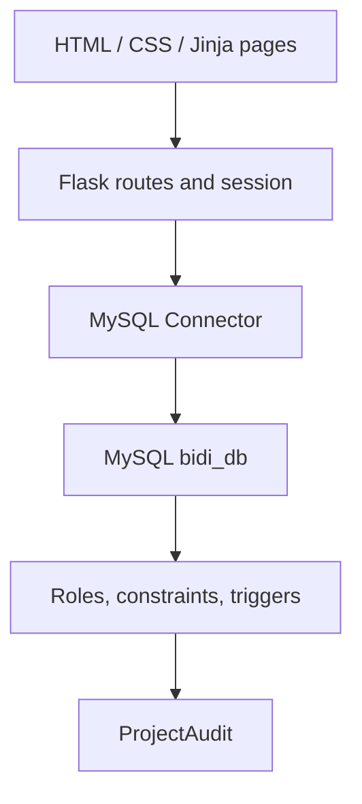

# BiDi Project Management Database

A database-backed project management demo built with **MySQL**, **Python Flask**, and a server-rendered **HTML/CSS** interface. It models customers, projects, employees, departments, locations, roles, and work assignments while demonstrating relational constraints, SQL queries, indexing, audit triggers, and database-enforced access control.

> **Academic-use disclaimer:** BiDi is a fictional company used for this academic project. All company, customer, employee, project, and related sample data in this repository are fictitious and provided solely for educational and demonstration purposes. They do not represent real organizations, individuals, or business records.

## Repository branches

> **The database scripts and web application are stored in different branches of this repository.** Both branches are required to run the complete demo.

| Branch | Contents | Link |
| --- | --- | --- |
| `Datebase` (default) | Database schema, seed data, indexes, views, queries, triggers, and MySQL roles | [Database SQL scripts](https://github.com/HongyaoLiu123/Database_BiDi/tree/Datebase) |
| `bidi_frontend` | Flask backend, Jinja HTML pages, CSS, and Python dependencies | [Web application](https://github.com/HongyaoLiu123/Database_BiDi/tree/bidi_frontend) |

**Note:** `bidi_frontend` is a Git branch, not a subdirectory of `Datebase`. Switching branches replaces the files in your working tree. Clone the two branches into separate directories when setting up the full application.

## Features

- **Relational data model:** 11 tables, including junction tables for employee assignments, roles, and groups, plus a project audit log.
- **Project management:** View, filter, and sort projects; the project manager interface also supports creating, updating, deleting, and assigning employees to projects.
- **Employee directory:** Browse employees alongside departments and locations, with department filtering and sorting.
- **Role-based access control:** Distinct project manager and customer support accounts, backed by MySQL roles and table-level privileges. The support role has read-only project access.
- **Validation:** Foreign keys, `CHECK` constraints, and a trigger preventing work assignments earlier than the project start date.
- **Audit trail:** Triggers record project insertions, updates, and deletions in `ProjectAudit`, viewable in the web interface.
- **SQL reporting:** Multi-table `JOIN` queries, aggregations, and a `vw_project_overview` view.
- **Query performance:** Indexes on commonly joined, filtered, and sorted columns.

## Technology stack

| Layer | Technology |
| --- | --- |
| Database | MySQL |
| Backend | Python, Flask 3.0.3 |
| Database driver | mysql-connector-python 9.0.0 |
| Frontend | HTML, CSS, Jinja templates |
| Database features | Constraints, views, triggers, indexes, roles and grants |

## Architecture



The backend opens database connections using the MySQL account associated with the logged-in demo user. Thus, database privileges provide an additional enforcement layer beyond the interface's role-specific controls.

## Project files

### `Datebase` branch — SQL

| File | Purpose |
| --- | --- |
| `create_database.sql` | Creates `bidi_db`, its tables, relationships, and constraints |
| `insert_sample_data.sql` | Populates example customers, employees, projects, and assignments |
| `indexes.sql` | Creates indexes for common access patterns |
| `views_queries.sql` | Defines `vw_project_overview` and provides demonstration SQL queries and data changes |
| `triggers.sql` | Adds project audit triggers and assignment-date validation |
| `roles_users.sql` | Configures MySQL roles, demo users, and grants |

### `bidi_frontend` branch — application

| File | Purpose |
| --- | --- |
| `app.py` | Flask routes, MySQL access, sessions, and project operations |
| `requirements.txt` | Python dependencies |
| `login.html`, `dashboard.html` | Login page and dashboard |
| `projects.html`, `employees.html` | Project management and employee directory |
| `overview.html`, `audit.html` | SQL view and audit log pages |
| `base.html` | Shared page layout/navigation |
| `style.css` | Application styles |

## Local setup

### Prerequisites

- A running MySQL server that supports the SQL features used here, including roles and enforced `CHECK` constraints (MySQL 8.0.16+ recommended).
- Python 3 and `pip`.
- A MySQL account with sufficient privileges to create the schema, triggers, roles, and demo users.

### 1. Clone both branches

```bash
git clone --branch Datebase https://github.com/HongyaoLiu123/Database_BiDi.git bidi-sql
git clone --branch bidi_frontend https://github.com/HongyaoLiu123/Database_BiDi.git bidi-web
```

### 2. Initialize the database

Run these scripts using a suitably privileged MySQL account:

```bash
cd bidi-sql
mysql -u root -p < create_database.sql
mysql -u root -p bidi_db < triggers.sql
mysql -u root -p bidi_db < insert_sample_data.sql
mysql -u root -p bidi_db < indexes.sql
mysql -u root -p bidi_db < views_queries.sql
mysql -u root -p bidi_db < roles_users.sql
```

**Warning:** `create_database.sql` starts with `DROP DATABASE IF EXISTS bidi_db`, so running it **destroys any existing `bidi_db` data**. Use a development database only.

**Note:** `views_queries.sql` is not strictly read-only: it includes demonstration `INSERT`, `UPDATE`, and `DELETE` statements, which change sample data. It also creates the `vw_project_overview` view, required by `roles_users.sql` and the web app.

### 3. Set up the Flask application

```bash
cd ../bidi-web
python -m pip install -r requirements.txt
```

Flask expects Jinja templates in a `templates/` folder and static assets in a `static/` folder. The current branch stores them at its root, so organize them locally before starting:

```text
bidi-web/
├── app.py
├── requirements.txt
├── templates/
│   ├── base.html
│   ├── login.html
│   ├── dashboard.html
│   ├── employees.html
│   ├── projects.html
│   ├── overview.html
│   └── audit.html
└── static/
    └── style.css
```

The current `app.py` also contains machine-specific and hard-coded database credentials. **Before running, replace these with your own local configuration and move secrets to environment variables.** Ensure that the configured MySQL demo users match the accounts created by `roles_users.sql`. Do not deploy the current demo authentication or `debug=True` configuration to production.

Then run:

```bash
python app.py
```

Open `http://127.0.0.1:5000/` in a browser. The login page documents the two demo roles, but these example credentials must never be reused on a real server.

## Main web pages

| Route | Function |
| --- | --- |
| `/login` | Demo-user sign-in and database connectivity indicator |
| `/dashboard` | Feature navigation and role summary |
| `/employees` | Department-filtered employee directory |
| `/projects` | Project filters, sorting, work assignments, and role-dependent editing |
| `/overview` | Database view `vw_project_overview` |
| `/audit` | Audit records from project triggers |
| `/logout` | Clear the login session |

## Current scope and limitations

This repository is an educational database and Flask demonstration, **not a production-ready system**. At the time of writing:

- SQL and application files are separated across two branches.
- The application HTML/CSS assets require placement in Flask's conventional `templates/` and `static/` directories.
- Database credentials and the Flask secret key are hard-coded in `app.py`; they should be removed from source and any exposed passwords rotated.
- Authentication uses fixed demo accounts; production authentication, secret management, testing, and deployment configuration are outside the present implementation.

## Suggested improvements

- Consolidate SQL and web-app code into one organized project structure.
- Load credentials and Flask settings from environment variables.
- Add automated tests for role permissions, constraints, and triggers.
- Add screenshots and an entity-relationship diagram.

## Author

[Hongyao Liu](https://github.com/HongyaoLiu123)
